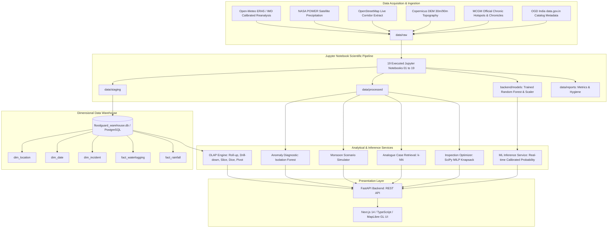

# System Architecture — FloodGuard X

## Overview
**FloodGuard X** is a production-grade urban flood intelligence, waterlogging analysis, and intervention planning system designed specifically for the Mumbai Metropolitan Region (MMR). It synthesizes real-world meteorological, topographic, and civic incident datasets into a unified dimensional data warehouse, applies calibrated machine learning models, executes multi-dimensional OLAP queries, and exposes analytical outputs through a high-performance FastAPI service and an interactive Next.js web application.

## Core Subsystems

### 1. Data Pipeline & Storage Hierarchy
- **`data/raw/`**: Exact, unmodified downloaded datasets from public institutions (NASA, Copernicus, OpenStreetMap, Open-Meteo, MCGM).
- **`data/staging/`**: Cleaned, schema-standardized CSV files with validated geographic coordinates (18.85°N-19.35°N, 72.75°E-73.10°E) and normalized timestamps.
- **`data/processed/`**: Engineered hydrometeorological feature matrices, clustered geospatial coordinates, and detected anomalies.
- **`data/manifests/`**: Machine-readable JSON and CSV manifests auditing publisher provenance, license terms, spatial/temporal grain, completeness, and known limitations.

### 2. Scientific Experimentation in Jupyter
- 19 sequentially executed `.ipynb` notebooks covering the complete lifecycle:
  - Environment audit
  - Provenance discovery
  - Rainfall distributions
  - Geospatial GIS extraction
  - Data hygiene
  - Warehouse modeling
  - Feature engineering
  - Spatial DBSCAN clustering
  - Isolation Forest anomaly detection
  - Chronological model training (2010-2021 train, 2022-2024 test)
  - Explainability & calibration
  - Scenario simulation
  - k-NN case analogy
  - Critical facility proximity
  - Budget optimization
  - End-to-end integration verification

### 3. Dimensional Data Warehouse (OLAP)
- Star schema with 5 dimensions (`dim_date`, `dim_location`, `dim_weather`, `dim_incident`, `dim_intervention`) and fact tables (`fact_waterlogging`, `fact_rainfall`).
- Native SQL execution of all 5 OLAP operations:
  1. **Roll-up**: Aggregates incident counts and flood duration to administrative ward levels.
  2. **Drill-down**: Breaks down multi-year incident volumes into monthly and daily storm events.
  3. **Slice**: Isolates a single dimensional slice (e.g. Ward = 'F/North').
  4. **Dice**: Multi-dimensional sub-cube cut (e.g. Wards in ('F/North', 'H/West', 'L') AND Rainfall >= 80mm).
  5. **Pivot**: Cross-tabulates Ward rows against Severity columns.

### 4. Machine Learning & Optimization Services
- **Risk Prediction**: Calibrated Random Forest model predicting binary flood severity probability, accompanied by 95% confidence intervals derived from tree ensemble variance.
- **Inspection Budget Optimizer**: Mixed Integer Linear Program (MILP) solved using `scipy.optimize.milp` to maximize pre-monsoon risk reduction within municipal capital constraints.
- **Case Analogy**: Vector nearest-neighbor search (`sklearn.neighbors.NearestNeighbors`) matching incoming storm forecasts with verified past Mumbai episodes.

### 5. Backend Service
- Built with **FastAPI**, **Pydantic v2**, and **SQLite/PostgreSQL** connectors.
- Stateless, asynchronous endpoints with input boundary validation, JSON schema definitions, and automated model artifact loading into memory on boot.

### 6. Interactive Frontend
- Built with **Next.js 14**, **React 18**, **TypeScript**, and **Tailwind CSS**.
- **MapLibre GL JS** interactive map rendered with CartoDB Positron neutral base tiles.
- Strictly adheres to the neutral, professional product design tokens:
  - Background: `#F5F5F2`
  - Main Surface: `#FFFFFF`
  - Sidebar: `#F0F0EC`
  - Primary Text: `#242722`
  - Secondary Text: `#686B65`
  - Borders: `#DCDDD6`
  - Primary Action: `#40584B`
  - Secondary Accent: `#74877B`
  - Information: `#657887`
  - Warning: `#A77936`
  - High Risk: `#A64E45`
  - Low Risk: `#6E8975`
