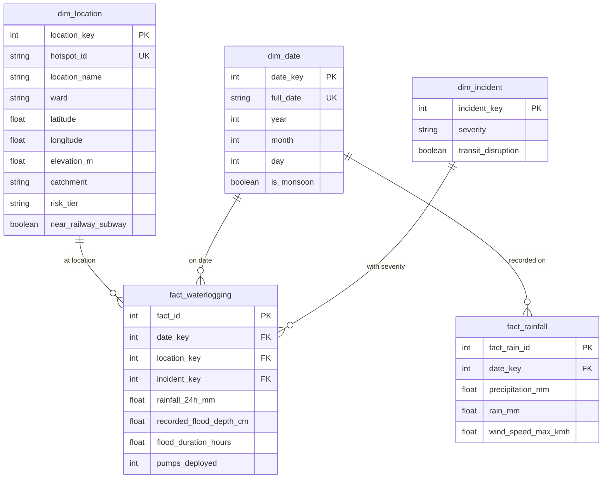

# Dimensional Data Warehouse Schema & OLAP Guide — FloodGuard X

## Star Schema Architecture
FloodGuard X implements a dimensional star schema designed to support high-performance analytical queries and standard On-Line Analytical Processing (OLAP) operations.



---

## The 5 Core OLAP Operations

### 1. Roll-up (Dimension Hierarchy Aggregation)
Aggregates granular flood facts up from individual spot locations to the overarching MCGM Administrative Ward level.
```sql
SELECT l.ward,
       COUNT(f.fact_id) as total_incidents,
       ROUND(AVG(f.recorded_flood_depth_cm), 1) as avg_flood_depth_cm,
       ROUND(SUM(f.flood_duration_hours), 1) as total_duration_hours,
       SUM(f.pumps_deployed) as total_pumps_deployed
FROM fact_waterlogging f
JOIN dim_location l ON f.location_key = l.location_key
GROUP BY l.ward
ORDER BY total_incidents DESC;
```

### 2. Drill-down (Temporal Granularity Disaggregation)
Drills down from multi-year macro aggregates into specific annual and monthly seasonal spikes.
```sql
SELECT d.year, d.month,
       COUNT(f.fact_id) as incident_count,
       ROUND(AVG(f.recorded_flood_depth_cm), 1) as avg_depth_cm,
       ROUND(MAX(f.recorded_flood_depth_cm), 1) as max_depth_cm,
       ROUND(AVG(f.rainfall_24h_mm), 1) as avg_rainfall_mm
FROM fact_waterlogging f
JOIN dim_date d ON f.date_key = d.date_key
GROUP BY d.year, d.month
ORDER BY d.year DESC, d.month ASC;
```

### 3. Slice (Single Dimension Filtering)
Isolates a single slice of the data cube along a specific dimension (e.g. Ward = 'F/North').
```sql
SELECT l.location_name, l.ward,
       COUNT(f.fact_id) as incidents,
       ROUND(AVG(f.rainfall_24h_mm), 1) as avg_rain_mm,
       ROUND(AVG(f.recorded_flood_depth_cm), 1) as avg_depth_cm
FROM fact_waterlogging f
JOIN dim_location l ON f.location_key = l.location_key
WHERE l.ward = 'F/North'
GROUP BY l.location_name, l.ward;
```

### 4. Dice (Multi-Dimensional Sub-Cube Intersection)
Extracts a sub-cube defined by constraints across multiple dimensions (e.g. Wards in ('F/North', 'H/West', 'L') AND Rainfall >= 80mm).
```sql
SELECT l.ward, l.location_name, l.risk_tier,
       COUNT(f.fact_id) as severe_episodes,
       ROUND(AVG(f.recorded_flood_depth_cm), 1) as avg_depth_cm,
       ROUND(AVG(f.flood_duration_hours), 1) as avg_duration_hours
FROM fact_waterlogging f
JOIN dim_location l ON f.location_key = l.location_key
WHERE f.rainfall_24h_mm >= 80.0
GROUP BY l.ward, l.location_name, l.risk_tier
ORDER BY severe_episodes DESC;
```

### 5. Pivot (Dimensional Rotation / Cross-Tabulation)
Rotates the data cube, turning unique values of `dim_incident.severity` into distinct summary columns grouped by `dim_location.ward`.
```sql
SELECT l.ward,
       SUM(CASE WHEN i.severity = 'Critical' THEN 1 ELSE 0 END) as critical_count,
       SUM(CASE WHEN i.severity = 'High' THEN 1 ELSE 0 END) as high_count,
       SUM(CASE WHEN i.severity = 'Moderate' THEN 1 ELSE 0 END) as moderate_count,
       COUNT(f.fact_id) as total_events
FROM fact_waterlogging f
JOIN dim_location l ON f.location_key = l.location_key
JOIN dim_incident i ON f.incident_key = i.incident_key
GROUP BY l.ward
ORDER BY critical_count DESC;
```
